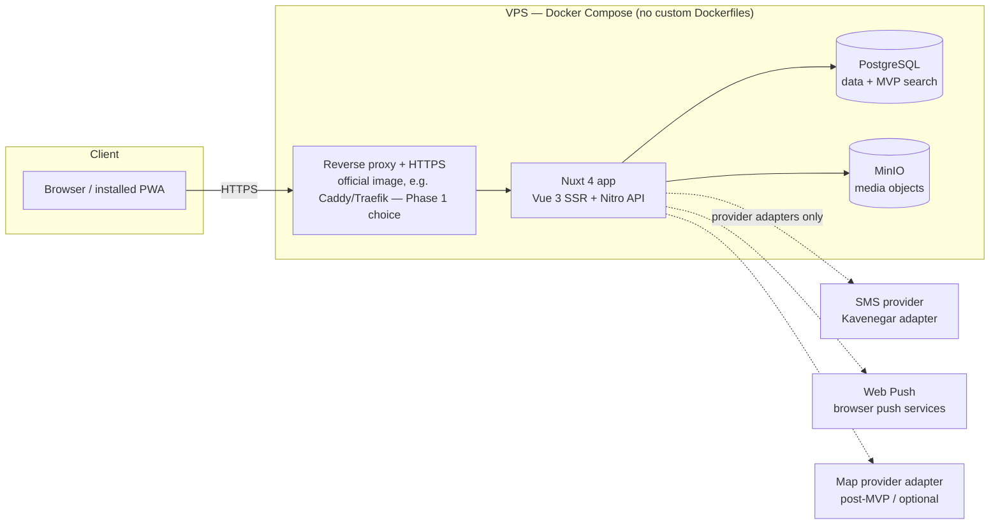

# Architecture — Dorehami

Status: Phase 0 proposal. Stack choices are **Proposed** in ADRs and require version-compatibility validation in Phase 1. No code exists yet.

## 1. Overview

A **modular monolith** (ADR-0002): one Nuxt 4 application (Vue 3 + TypeScript strict) with Nitro server routes, SSR for public/SEO pages, deployed with Docker Compose on a single VPS. PostgreSQL (Drizzle ORM) is the only primary datastore; MinIO holds media; PostgreSQL also provides MVP search (ADR-0010). This optimizes for a small team, transactional integrity (capacity!), and operational simplicity. Microservices, Elasticsearch, and heavy analytics are explicitly out of scope.

## 2. Trust boundaries

- **TB1 Internet ↔ reverse proxy/app:** all public input untrusted; rate limiting, validation, security headers at this edge.
- **TB2 App ↔ PostgreSQL/MinIO:** private network only (Compose network); DB and MinIO consoles never publicly exposed; MinIO objects private by default, served via signed URLs or app proxy (ADR-0011).
- **TB3 App ↔ external providers:** only through adapter interfaces (§5); no provider payloads or secrets leak into domain code or logs.
- **TB4 Admin surface:** same app, route + server-side role enforcement, audit-logged; never indexable.

## 3. Module boundaries (Proposed — Phase 1 validates)

Server code is organized by domain module; UI components consume application services/use-cases, never the DB directly. Dependencies point **inward**: `ui → application → domain`; infrastructure (DB, providers) implements ports defined by application/domain.

| Module | Responsibility | May depend on | Must not depend on |
|---|---|---|---|
| `identity` | Users, OTP challenges, sessions, passwords, profiles, privacy settings | platform (config, audit) | events, communities |
| `catalog` | Categories, cities, interests taxonomy | platform | identity internals |
| `events` | Events, series, occurrences, registrations, ICS | identity (authz), catalog, media, notifications (port) | communities internals (only via linked-community id + service interface) |
| `communities` | Communities, memberships, posts, comments, reactions | identity, catalog, media | events internals |
| `messaging` | Direct conversations/messages | identity | everything else |
| `notifications` | In-app notifications, push subscriptions/dispatch | identity; consumes domain events from other modules | provider SDKs directly (adapter port only) |
| `moderation` | Content reports, publication review queues | identity, events, communities (via service interfaces) | — |
| `admin` | Admin use-cases over other modules' services | all module **services** (not tables directly) | bypassing module invariants |
| `media` | Media assets, upload validation, signed access | platform (MinIO adapter) | domain modules |
| `platform` | Config & brand config, DB client, audit log, rate limiting, provider adapters, i18n/date utils | — | any domain module |

Cross-module communication: synchronous service calls for reads/invariants within one transaction where needed (registration), and **in-process domain events** (e.g. `registration.created`, `occurrence.cancelled`) for notifications — no message broker in MVP (Provisional; revisit only with measured need).

## 4. Data flow examples

- **Registration (write, transactional):** Nitro route → authz → events application service → single DB transaction: check occurrence state + duplicate + capacity (row lock / conditional update, ADR-0008) → insert registration → commit → emit domain event → notification. No partial states visible.
- **Public event page (read, SSR):** Nitro SSR → events query service (published-only filter enforced in query) → localized, calendar-converted view model → HTML with SEO meta; attendee data included only if public per privacy rules and never for anonymous viewers beyond aggregate counts.
- **Upload:** route → media service validates size/MIME by content sniffing → MinIO put (private bucket) → media asset row → referenced by event/community/profile; access via short-lived signed URLs.

## 5. External provider adapters (ADR-0015)

Ports: `SmsProvider` (send OTP), `PushProvider` (web-push dispatch), `EmailProvider` (optional/future), `MapProvider` (optional/future). Adapters: Kavenegar (SMS, initial), mock SMS (**dev/test only** — production fails fast if selected or if required config is missing), web-push via VAPID. Domain logic never imports a provider SDK. Provider failure = explicit error state, never simulated success (THREAT-MODEL T-22).

## 6. Cross-cutting concerns

- **Validation:** schema validation at every API boundary (ADR via API-CONTRACTS); TypeScript strict end-to-end.
- **AuthN/AuthZ:** server-side on every route (ADR-0005/0006).
- **Config:** validated at startup; app refuses to boot in production with missing required secrets (ENVIRONMENT-AND-SECRETS).
- **Brand config:** single source for name/tagline/tokens (ADR-0019).
- **Observability (MVP-minimal):** structured server logs with secret redaction, health endpoint, audit log for admin actions. No heavy analytics.
- **Caching:** none by default; HTTP caching for static/public assets and (Phase 1 decision) possibly short-TTL public page caching — only where measured.

## 7. Deployment model (summary; detail in OPERATIONS)

Docker Compose with official images pinned by digest. App-image strategy (Phase 0.1, ADR-0018): CI assembles a Dockerfile-less OCI image (`crane append` of the Nitro `.output` onto the official Node 24 image) referenced **by digest** in production; Option B (verified tarball + bind mount) is the documented fallback and Option C (custom Dockerfile) requires founder-approved supersession. Persistent volumes for PostgreSQL and MinIO, reverse proxy with HTTPS, documented backup/restore. Environments: local dev, (optional) staging, production — same Compose topology; bind mounts exist only in dev.
