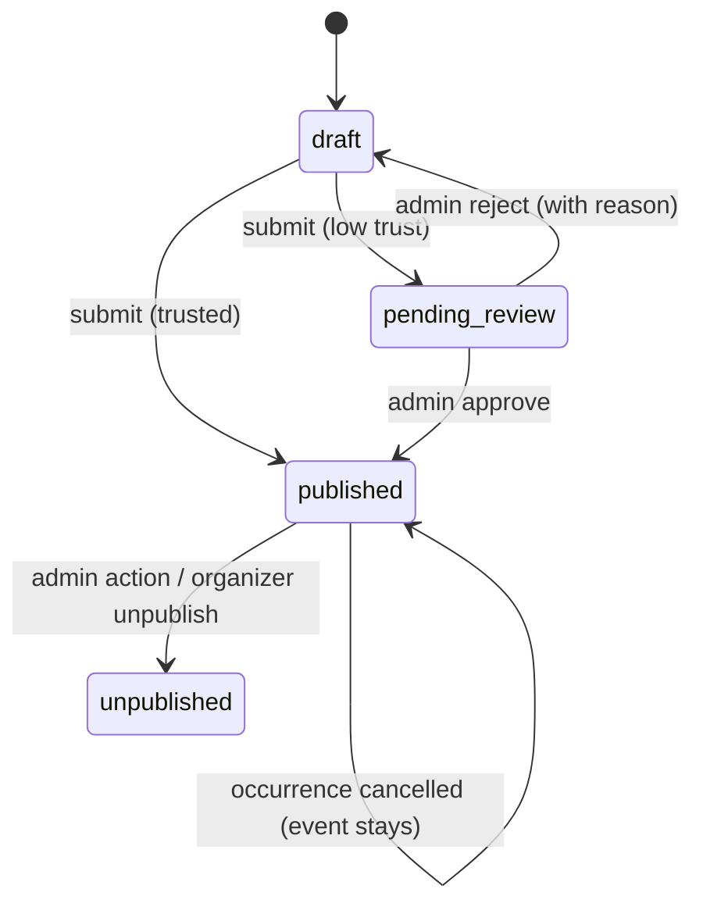

# Domain Model — Dorehami

Business rules, states, and invariants. Schema-level detail (fields, keys, indexes) is in [ERD.md](ERD.md); both documents must stay consistent. Labels: Confirmed / Provisional as in PRD.

## 1. Identity

- One **User** account; capabilities (organizer, admin) attach to it (ADR-0006). Auth identifiers: phone (unique, E.164 stored, Provisional format `+98…` default — D-09) and optional password.
- **OTP challenge**: one active challenge per phone+purpose; hashed code only; expiry (Provisional 5 min), max attempts (5), resend cooldown (60s), per-phone/IP rate limits. Verification consumes the challenge (single use — no replay).
- **Session**: server-side, opaque token in HttpOnly Secure cookie; rotation on login and privilege change; logout invalidates server-side; idle/absolute lifetimes in SECURITY-BASELINE §3.
- **Profile**: display name, bio, avatar, city preference, interests, privacy settings (`profile_visibility`, `attendee_list_visibility`: public / participants-only / hidden — defaults Provisional: participants-only).

## 2. Organizers

- **Organizer capability** is granted by self-service activation (Provisional) and carries a **verification/trust level**: `new → established` (criteria Provisional: verified phone + N successfully completed events without upheld reports — exact thresholds Open D-04). Admins may suspend the capability.
- New/low-trust organizers' events and communities enter **publication review**; established organizers publish directly but remain reportable/moderatable.

## 3. Events, series, occurrences

- An **Event** is the public, discoverable description. It either is single (one occurrence) or belongs to an **EventSeries** whose recurrence rule generates **Occurrences**. Even single events have exactly one occurrence, so registration logic is uniform.
- Recurrence rule (Provisional): RFC-5545-inspired subset — frequency (daily/weekly/monthly), interval, weekdays, end by date or count, all anchored to the event's timezone with an explicit materialization window (Provisional: generate/refresh occurrences up to 6 months ahead; occurrences are real rows, editable individually once materialized).
- **Cancelling one occurrence never affects the series or other occurrences.** Series cancellation is a separate explicit action that cancels all future (not past) occurrences and notifies registrants. "This and following" edits are post-MVP unless Phase 4 proves them cheap and safe (Provisional).
- Occurrence states: `scheduled → cancelled` (terminal) ; an occurrence in the past is `completed` by time derivation, not a stored mutation (Provisional). Event publication states: `draft → pending_review → published → rejected/unpublished` (admin) ; `published → cancelled` only via occurrence/series cancellation semantics.
- Format: `in_person` (city + venue text; map link via adapter optional), `online` (join details revealed per §J1 policy), `hybrid` (both).

## 4. Registration & capacity (transactional core)

Invariants (Confirmed):

1. A user may hold at most **one active registration per occurrence** (unique constraint + service check; cancelled registrations don't block re-registering).
2. Confirmed registrations for an occurrence **never exceed capacity**, including under concurrency.
3. Registration ≠ attendance; no attendance state exists in MVP.

Mechanics (ADR-0008): single transaction — lock the occurrence row (`SELECT … FOR UPDATE`) or atomic conditional counter update; check state `scheduled`, `registered_count < capacity`, no active duplicate; insert registration and increment counter (or compute count with locking — Phase 4 picks one, must prove with a concurrency test). Registration states: `confirmed → cancelled_by_user | cancelled_by_event`. Capacity edits: increasing is free; decreasing below current confirmed count is **rejected**. Registration closes at occurrence start (Provisional: also organizer-settable close time, D-10).

## 5. Cancellation policies (must be shown to users before registering)

- **Attendee cancellation (Provisional policy, validate D-10):** free, self-service, until occurrence start; frees capacity immediately; no penalty in MVP.
- **Event/occurrence cancellation by organizer:** allowed any time before start; all confirmed registrants are notified in-app (+push if enabled) and registrations become `cancelled_by_event`. Reason optional-but-prompted.

## 6. Communities & content

- **Community**: public in MVP; founder becomes first manager. States: `draft → pending_review → published → suspended( admin )`. Membership roles: `member`, `manager`. Join: instant, or approval-required if founder enables it (A-3, Provisional). Leaving: immediate; sole manager must appoint a successor or archive the community first (D-13).
- **Event ↔ community:** an event links to at most one community (A-4); linking requires the organizer to be a manager of that community (Provisional).
- **Post/Comment/Reaction:** posts by members; comments on posts (one level nesting, Provisional); reactions are (user, target, type) unique. States: `published → hidden (moderation) → removed`. Editing keeps no public history in MVP (Provisional).
- **Reports:** any authenticated user may report content/users; states `open → under_review → resolved_action_taken | resolved_no_action`; reporter identity visible to admins only.

## 7. Messaging

Conversation = exactly 2 participants (unique pair). Messages readable **only** by participants — enforced server-side on every read/write. Initiation authorization per USER-FLOWS J5 (shared context only, per D-07; no message-request inbox in the recommendation). No group chat in MVP.

## 8. Notifications

In-app notification per user with `read_at`; types enumerated in code later (registration, cancellation, review outcome, comment/reaction, message, membership). Push only with an active PushSubscription and per-type user preference. Notification content must never contain private message bodies beyond a minimal preview policy (Provisional: sender name only) and links must be internal, validated paths (THREAT-MODEL T-21).

## 9. Deletion, deactivation, retention

- **Soft delete** for domain content where other users' data depends on it (events with registrations, communities with members, posts with comments): state-flag + `deleted_at`, excluded from public queries, retained for audit/disputes (retention period is founder/legal decision D-06 — no period is asserted here; the 12-month figure from Phase 0 is withdrawn pending that decision).
- **Hard delete** for: expired OTP challenges (immediately/cron), revoked sessions, and personal data on account-deletion request after the retention window.
- **Account deletion consequences (must be shown pre-confirmation):** future registrations cancelled; organizer events/communities must be transferred or are unpublished; public posts/comments anonymized to a deleted-user placeholder (personal data removed); DMs retained for the other participant with the sender anonymized (Provisional — D-06); audit-log entries about the user are retained (append-only) with minimal data.
- **AuditLog is append-only at the application level:** no update/delete endpoints or ORM paths; DB-level restriction recommended in Phase 8 hardening.

## 10. Event-domain edge cases (normative, Phase 0.1)

- **Concurrent registration at capacity:** ADR-0008 governs; the losing requests receive `409 EVENT_FULL`, never a waitlist entry (out of scope) and never an over-capacity confirmation. A client retry of a successful registration returns the existing registration (`409 ALREADY_REGISTERED` + existing resource), not an error that implies failure.
- **Event edits after registrations exist:** title/description/media edits are free. **Material changes** (occurrence start/end, timezone, location/venue, format, online link) follow ADR-0007: allowed only for future occurrences, confirmed registrants are notified with old→new values, and registrations are preserved. Capacity decrease below the confirmed count is rejected (`CAPACITY_BELOW_REGISTRATIONS`); capacity increase takes effect immediately.
- **Reschedule vs cancel:** rescheduling keeps registrations; cancelling voids them (`cancelled_by_event`). Organizers pick explicitly — the API must not expose an edit that silently behaves as cancel+recreate (existing registrations and notification history would be lost).
- **Organizer suspended (capability suspended by admin, or account suspended):** creating/editing events is blocked; future occurrences of their events are **not** auto-cancelled by the system. Admin chooses per case: leave published (with organizer unable to manage — flagged in admin UI), unpublish, or cancel-with-notification. The chosen action is audited. Organizer public page shows a suspended/not-available state without exposing the reason.
- **Organizer account deletion:** per §9 the organizer must first transfer or unpublish/cancel future events; if they do not, deletion execution cancels future occurrences with notification to registrants and anonymizes the organizer page. Past events remain as historical, anonymized records.
- **Community deletion / event ownership:** deleting (archiving) a community never deletes its linked events. Linked events become standalone (`community_id` set null in the same transaction) and their organizer keeps full ownership — community membership/management never conferred event rights (ADR-0006). Members are notified of the archival; posts become read-only archived content per §9 retention, not public after archival.
- **Account deletion & phone reuse:** after anonymization completes, the phone number is released and may register a new account (the anonymized row keeps no phone). During `deletion_pending`, login is blocked and the phone cannot start a new registration. (Legal hold exception: D-06.)
- **Suspended user:** sessions revoked, login blocked with `ACCOUNT_SUSPENDED`, existing future registrations cancelled-with-notification to organizers (counts only), content remains published unless separately moderated. Restoration re-activates login but does **not** restore cancelled registrations.

## 11. Authorization & privacy matrix (normative)

Legend: ✔ allowed · — denied · ◐ scoped/partial. Server enforces every cell (ADR-0006).

| Action | Anonymous | Authenticated non-member | Community member | Community manager | Event organizer (owner) | Platform admin |
|---|---|---|---|---|---|---|
| View public event/community/organizer page | ✔ | ✔ | ✔ | ✔ | ✔ | ✔ |
| Register for occurrence / cancel own registration | — | ✔ (own only) | ✔ (own only) | ✔ (own only) | ✔ (own only; not auto-registered) | — (no on-behalf registration in MVP) |
| View attendee list of an occurrence | counts only | ◐ only if own registration + each attendee's setting permits | ◐ same | ◐ same (no extra rights from community role) | ◐ display names per each attendee's setting; **never phone numbers** | — (no bulk export; case-by-case moderation view, audited) |
| Create/edit/cancel event & occurrences | — | — (needs organizer capability) | — | — (needs organizer capability; community role grants nothing) | ✔ own events only | ◐ moderation: unpublish/cancel with audit |
| Link event to a community | — | — | — | ✔ only if also the event's organizer | ✔ only for communities they manage | — |
| Edit community / approve or remove members / moderate its posts | — | — | — | ✔ that community only | ◐ only if also a manager of it | ◐ suspend/restore, audited |
| Post / comment / react in a community | — | — | ✔ | ✔ | ◐ only as a member/manager | — (moderation via hide/remove, audited) |
| Send DM | — | ◐ only within J5 contexts & not blocked | ◐ same | ◐ same | ◐ same | — |
| Block / unblock a user (if D-05 approved) | — | ✔ own block list | ✔ | ✔ | ✔ | — |
| Manage own profile/privacy/sessions | — | ✔ own only | ✔ | ✔ | ✔ | — |
| Suspend user / verify organizer / resolve reports / edit taxonomies / view audit log | — | — | — | — | — | ✔ audited, confirmed |

**Attendee-list privacy resolution (fixes Phase 0 ambiguity):** attendee identities are **never shown to anonymous visitors** (counts only). The `attendee_list_visibility` setting means: `hidden` = nobody but self; `participants-only` (default) = other confirmed registrants of that occurrence and the organizer; `public` = any *authenticated* user. Organizers additionally always see the confirmed count and display names of `participants-only`/`public` attendees for their own occurrence — required to run the event — but never contact details.

## 12. Direct-message blocking (proposed, pending founder approval D-05)

Recommendation: **blocking is in MVP**. If approved: a block is directional (`user_blocks`), prevents the blocked party from initiating a new conversation and from sending further messages in an existing conversation (the blocker may still read history), is invisible to the blocked party (their sends fail with a generic `MESSAGE_NOT_DELIVERED`-style state — Phase 5 fixes exact UX without confirming the block), and can be lifted by the blocker at any time. Reporting remains separate and available regardless of block state. If the founder rejects blocking for MVP, §7/J5 ship with report-only and this section is removed by the Phase 5 change — the ERD marks `user_blocks` accordingly.

## 13. State transition summary

Every transition is validated server-side; invalid transitions return `409` with a stable error code (API-CONTRACTS §4).
