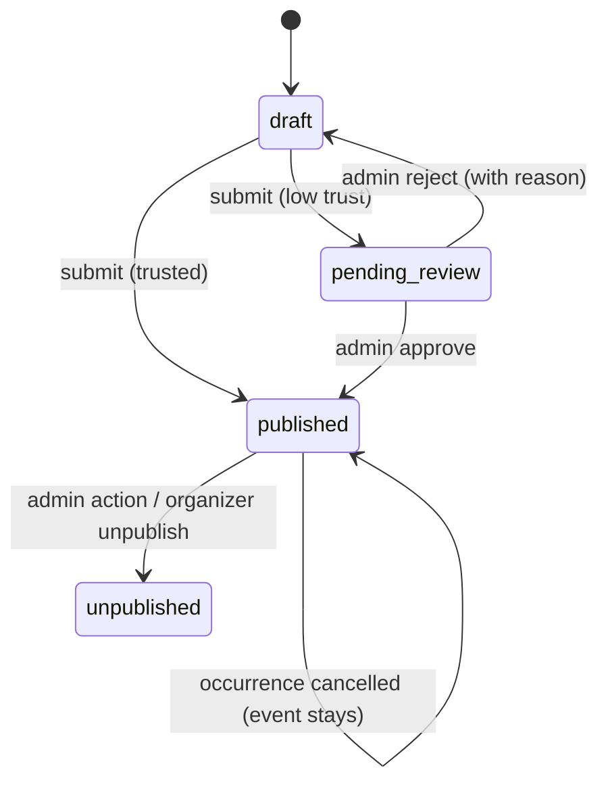

# Domain Model — Dorehami

Business rules, states, and invariants. Schema-level detail (fields, keys, indexes) is in [ERD.md](ERD.md); both documents must stay consistent. Labels: Confirmed / Provisional as in PRD.

## 1. Identity

- One **User** account; capabilities (organizer, admin) attach to it (ADR-0006). Auth identifiers: phone (unique, E.164 stored, Provisional format `+98…` default — Q-08) and optional password.
- **OTP challenge**: one active challenge per phone+purpose; hashed code only; expiry (Provisional 5 min), max attempts (5), resend cooldown (60s), per-phone/IP rate limits. Verification consumes the challenge (single use — no replay).
- **Session**: server-side, opaque token in HttpOnly Secure cookie; rotation on login and privilege change; logout invalidates server-side; idle/absolute lifetimes in SECURITY-BASELINE §3.
- **Profile**: display name, bio, avatar, city preference, interests, privacy settings (`profile_visibility`, `attendee_list_visibility`: public / participants-only / hidden — defaults Provisional: participants-only).

## 2. Organizers

- **Organizer capability** is granted by self-service activation (Provisional) and carries a **verification/trust level**: `new → established` (criteria Provisional: verified phone + N successfully completed events without upheld reports — exact thresholds Open Q-05). Admins may suspend the capability.
- New/low-trust organizers' events and communities enter **publication review**; established organizers publish directly but remain reportable/moderatable.

## 3. Events, series, occurrences

- An **Event** is the public, discoverable description. It either is single (one occurrence) or belongs to an **EventSeries** whose recurrence rule generates **Occurrences**. Even single events have exactly one occurrence, so registration logic is uniform.
- Recurrence rule (Provisional): RFC-5545-inspired subset — frequency (daily/weekly/monthly), interval, weekdays, end by date or count, all anchored to the event's timezone with an explicit materialization window (Provisional: generate/refresh occurrences up to 6 months ahead; occurrences are real rows, editable individually once materialized).
- **Cancelling one occurrence never affects the series or other occurrences.** Series cancellation is a separate explicit action that cancels all future (not past) occurrences and notifies registrants. "This and following" edits are post-MVP unless Phase 4 proves them cheap and safe (Provisional).
- Occurrence states: `scheduled → cancelled` (terminal) ; an occurrence in the past is `completed` by time derivation, not a stored mutation (Provisional). Event publication states: `draft → pending_review → published → rejected/unpublished` (admin) ; `published → cancelled` only via occurrence/series cancellation semantics.
- Format: `in_person` (city + venue text; map link via adapter optional), `online` (join details revealed per §J1 policy), `hybrid` (both).

## 4. Registration & capacity (transactional core)

Invariants (Confirmed):

1. A user may hold at most **one active registration per occurrence** (unique constraint + service check; cancelled registrations don't block re-registering).
2. Confirmed registrations for an occurrence **never exceed capacity**, including under concurrency.
3. Registration ≠ attendance; no attendance state exists in MVP.

Mechanics (ADR-0008): single transaction — lock the occurrence row (`SELECT … FOR UPDATE`) or atomic conditional counter update; check state `scheduled`, `registered_count < capacity`, no active duplicate; insert registration and increment counter (or compute count with locking — Phase 4 picks one, must prove with a concurrency test). Registration states: `confirmed → cancelled_by_user | cancelled_by_event`. Capacity edits: increasing is free; decreasing below current confirmed count is **rejected**. Registration closes at occurrence start (Provisional: also organizer-settable close time, Q-04).

## 5. Cancellation policies (must be shown to users before registering)

- **Attendee cancellation (Provisional policy, validate Q-04):** free, self-service, until occurrence start; frees capacity immediately; no penalty in MVP.
- **Event/occurrence cancellation by organizer:** allowed any time before start; all confirmed registrants are notified in-app (+push if enabled) and registrations become `cancelled_by_event`. Reason optional-but-prompted.

## 6. Communities & content

- **Community**: public in MVP; founder becomes first manager. States: `draft → pending_review → published → suspended( admin )`. Membership roles: `member`, `manager`. Join: instant, or approval-required if founder enables it (A-3, Provisional). Leaving: immediate; sole manager must appoint a successor or archive the community first (Q-03).
- **Event ↔ community:** an event links to at most one community (A-4); linking requires the organizer to be a manager of that community (Provisional).
- **Post/Comment/Reaction:** posts by members; comments on posts (one level nesting, Provisional); reactions are (user, target, type) unique. States: `published → hidden (moderation) → removed`. Editing keeps no public history in MVP (Provisional).
- **Reports:** any authenticated user may report content/users; states `open → under_review → resolved_action_taken | resolved_no_action`; reporter identity visible to admins only.

## 7. Messaging

Conversation = exactly 2 participants (unique pair). Messages readable **only** by participants — enforced server-side on every read/write. Initiation authorization per USER-FLOWS J5 (shared context or accepted request, Q-10). No group chat in MVP.

## 8. Notifications

In-app notification per user with `read_at`; types enumerated in code later (registration, cancellation, review outcome, comment/reaction, message, membership). Push only with an active PushSubscription and per-type user preference. Notification content must never contain private message bodies beyond a minimal preview policy (Provisional: sender name only) and links must be internal, validated paths (THREAT-MODEL T-21).

## 9. Deletion, deactivation, retention

- **Soft delete** for domain content where other users' data depends on it (events with registrations, communities with members, posts with comments): state-flag + `deleted_at`, excluded from public queries, retained for audit/disputes (Provisional retention 12 months, Q-12/legal).
- **Hard delete** for: expired OTP challenges (immediately/cron), revoked sessions, and personal data on account-deletion request after the retention window.
- **Account deletion consequences (must be shown pre-confirmation):** future registrations cancelled; organizer events/communities must be transferred or are unpublished; public posts/comments anonymized to a deleted-user placeholder (personal data removed); DMs retained for the other participant with the sender anonymized (Provisional — Q-12); audit-log entries about the user are retained (append-only) with minimal data.
- **AuditLog is append-only at the application level:** no update/delete endpoints or ORM paths; DB-level restriction recommended in Phase 8 hardening.

## 10. State transition summary

Every transition is validated server-side; invalid transitions return `409` with a stable error code (API-CONTRACTS §4).
