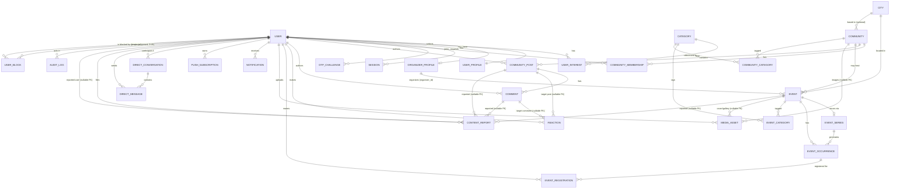

# ERD & Data Model — Dorehami

PostgreSQL via Drizzle (ADR-0003/0004). Conventions: `id uuid PK` (or `bigint identity` where Phase 1 benchmarks prefer — decide once, Provisional: UUID v7/uuid), `created_at/updated_at timestamptz` (UTC) on mutable rows, enums as PG enums or check-constrained text (Phase 1 picks one consistently). This document is the schema *design*; no migrations exist in Phase 0.

**Phase 0.1 corrections:** (1) `events.organizer_id` references **`organizer_profiles.user_id`**; (2) reactions/reports/media use explicit nullable FKs with exactly-one-target checks; (3) `user_blocks` added as **Proposed, contingent on founder approval D-05**; (4) occurrences gain `revision` (optimistic concurrency) and `individually_edited` (ADR-0007); (5) single stable ASCII slug per resource (D-08).

## 1. Diagram

> Reaction/report/media targets: explicit nullable FK columns (`post_id`, `comment_id`, …) with a `CHECK` that exactly one target is set — unconstrained polymorphic strings are rejected (Phase 0.1). Media assets follow the same pattern (nullable `event_id`/`community_id`; avatars are referenced from `user_profiles.avatar_media_id`). `event_occurrences.series_id`, when present, must satisfy `series.event_id = occurrence.event_id` (composite FK or trigger — Phase 4 picks and tests it).

## 2. Entity detail

Legend — PD: personal-data class (P0 public-by-design, P1 user-controlled, P2 sensitive/private, P3 secret — never stored in plaintext beyond hashing). Del: soft (S) / hard (H).

### Identity
| Entity | Key fields | Constraints / indexes | States | Del / PD |
|---|---|---|---|---|
| `users` | id, phone (unique, E.164), password_hash (nullable), status, is_platform_admin (see note), last_login_at | unique(phone); index(status) | `active → deactivated → deletion_pending → deleted(anonymized)` | S then anonymize / P2 |
| `user_profiles` | user_id PK/FK, display_name, bio, avatar_media_id, city_id, profile_visibility, attendee_list_visibility, locale_pref | FK city, media | — | S / P1 |
| `user_interests` | user_id, category_id | PK(user_id, category_id) | — | H on removal / P1 |
| `otp_challenges` | id, phone, purpose, code_hash, expires_at, attempts, consumed_at, requester_ip | index(phone, purpose); expiry sweep | `pending → consumed/expired/locked` | H (short retention) / P3 |
| `sessions` | id, user_id, token_hash (unique), expires_at, last_seen_at, user_agent, ip | unique(token_hash); index(user_id) | `active → revoked/expired` | H / P3 |
| `organizer_profiles` | user_id PK/FK, page_slug (unique), display_name, bio, verification_status, trust_level, suspended_at | unique(slug) | verification: `unverified → pending → verified/rejected` | S / P1 |

> Admin: `is_platform_admin` boolean on `users` is the Provisional MVP approach, grantable only via CLI/admin action and fully audit-logged (ADR-0006). If Phase 1 prefers a `platform_roles` table, keep the same semantics.

### Catalog
| Entity | Key fields | Constraints / indexes | Del / PD |
|---|---|---|---|
| `categories` | id, slug (unique per locale note), name_fa, name_en, parent_id, sort_order, is_active | unique(slug); index(parent_id) | S (deactivate) / P0 |
| `cities` | id, slug unique, name_fa, name_en, province/region, is_active | unique(slug) | S / P0 |

### Events
| Entity | Key fields | Constraints / indexes | States | Del / PD |
|---|---|---|---|---|
| `events` | id, organizer_id FK → `organizer_profiles(user_id)`, community_id FK nullable, title, description, format, city_id nullable, venue_text, online_url (protected), capacity_default, publication_status, content_locale, slug (single stable ASCII slug) | index(organizer_id), index(community_id), index(publication_status, created_at); unique(slug) | see DOMAIN-MODEL §3 | S / P0–P1 |
| `event_series` | id, event_id unique FK, recurrence_rule (jsonb, validated), timezone (IANA), series_end_at | — | `active → ended/cancelled` | S / P0 |
| `event_occurrences` | id, event_id FK, series_id FK nullable (must match series.event_id), starts_at, ends_at, capacity, registered_count, status, revision (int), individually_edited (bool) | **unique(event_id, starts_at)**; index(starts_at) where status='scheduled'; index(event_id) | `scheduled → cancelled` | S / P0 |
| `event_categories` | event_id, category_id | PK(event_id, category_id) | — | H / P0 |
| `event_registrations` | id, occurrence_id FK, user_id FK, status, registered_at, cancelled_at | **unique(occurrence_id, user_id) where status='confirmed'** (partial unique index); index(user_id, status) | `confirmed → cancelled_by_user/cancelled_by_event` | S / P1 |

Concurrency: registration runs in one transaction locking the occurrence row (or atomic `UPDATE … WHERE registered_count < capacity`); `registered_count` is a maintained counter reconciled by tests (ADR-0008).

### Communities & social
| Entity | Key fields | Constraints / indexes | States | Del / PD |
|---|---|---|---|---|
| `communities` | id, founder_id, name, description, city_id nullable, join_policy, publication_status, slug unique | index(publication_status); slug unique | DOMAIN-MODEL §6 | S / P0 |
| `community_categories` | community_id, category_id | PK pair | — | H / P0 |
| `community_memberships` | id, community_id, user_id, role, status | **unique(community_id, user_id)**; index(user_id) | `pending → active → left/rejected/removed` | S / P1 |
| `community_posts` | id, community_id, author_id, body, status | index(community_id, created_at desc) | `published → hidden → removed` | S / P1 |
| `comments` | id, post_id, author_id, parent_comment_id nullable, body, status | index(post_id, created_at) | same | S / P1 |
| `reactions` | id, user_id, post_id nullable, comment_id nullable, type | unique(user, target) per target type; check exactly-one-target | — | H / P1 |

### Messaging, notifications, moderation, platform
| Entity | Key fields | Constraints / indexes | Del / PD |
|---|---|---|---|
| `direct_conversations` | id, participant_a_id, participant_b_id (ordered pair), last_message_at | **unique(participant_a_id, participant_b_id)**; both FK users | S / P2 |
| `direct_messages` | id, conversation_id, sender_id, body, read_at | index(conversation_id, created_at) | S / P2 |
| `notifications` | id, user_id, type, payload (jsonb, minimal, no message bodies), read_at, link_path (internal validated) | index(user_id, read_at, created_at desc) | H after read window / P1 |
| `push_subscriptions` | id, user_id, endpoint (unique), keys, revoked_at | unique(endpoint) | H / P2 |
| `content_reports` | id, reporter_id, target type+ids, reason, details, status, handled_by | index(status, created_at) | S (retention D-06) / P2 |
| `media_assets` | id, uploader_id, bucket, object_key (unique), mime_type, size_bytes, width/height, status, event_id nullable FK, community_id nullable FK (≤1 owner set) | unique(object_key); index(event_id), index(community_id) | S→H after orphan sweep / P1 |
| `user_blocks` **(Proposed, D-05)** | id, blocker_id FK, blocked_id FK, created_at | **unique(blocker_id, blocked_id)**; check(blocker_id <> blocked_id); index(blocked_id) | H on unblock / P2 |
| `audit_logs` | id, actor_user_id, action, target_type, target_id, metadata (jsonb, minimal), ip, created_at | index(actor), index(target_type,target_id), index(created_at); **append-only** | never deleted in MVP / P2 |
| `system_settings` | key PK, value jsonb, updated_by | — | Only if genuinely needed (Provisional: feature flags like `push_enabled`, review thresholds). No secrets here — secrets live in env. / P0 |

`SystemSetting` is included provisionally for non-secret operational toggles; if Phase 1 finds env config sufficient, drop it (record the decision in ADR-0004 or a new ADR).

## 3. Global rules

- All timestamps UTC `timestamptz`; display conversion per [I18N-AND-DATE](I18N-AND-DATE.md). Recurrence anchored to event timezone (stored IANA name on series/event).
- Slugs: stable, never recycled; renames keep old slug redirecting (301) for public pages (SEO doc §2).
- No OTP codes, passwords (plaintext), session tokens (plaintext), or secrets in any table beyond hashes, and never in logs.
- Personal data minimization: no birthdate/gender/national-id fields in MVP (not required by any flow).
